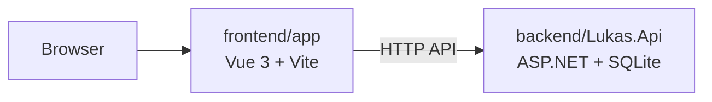
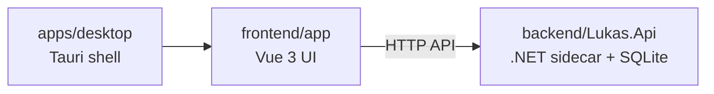

# Implementation details to discuss

This document is for concrete programming and tooling decisions. It should stay
separate from `technical-details.md`, which captures product architecture,
domain boundaries and higher-level technical decisions.

Implementation details belong here when they answer questions such as:

- Which .NET version and project templates to use.
- How to package the C# sidecar with Tauri.
- Which test frameworks to use.
- Which Vue setup and frontend tooling to use.
- How command/query DTOs are shared or generated.
- Which ORM, migration tool or SQL approach to use.
- How the local development workflow is run.
- Which formatting, linting, type-checking and CI commands exist.

## Current implementation direction

These are not final implementation decisions yet, but they follow from the
current technical direction:

- Desktop shell: Tauri.
- Frontend: Vue 3.
- Styling: CSS or SCSS, without Tailwind-like utility CSS.
- Backend/domain: C#/.NET sidecar.
- Local database: SQLite.
- Future cloud backend: ASP.NET API with PostgreSQL.

## Topics to decide

### Repository layout

- Monorepo structure for desktop app, Vue frontend, C# sidecar, domain projects,
  storage projects, importers and tests.
- Naming conventions for projects and modules.
- Where shared command/query contracts live.

Decision:

- Use a monorepo.
- Keep the Vue frontend separate from the Tauri desktop shell.
- The Vue app must be runnable directly in a browser against the .NET API,
  without Tauri.
- The Tauri app is a desktop shell/packaging layer that points at the same Vue
  app and starts or connects to the .NET API.
- Do not create a separate `apps/web` package at this stage. Add a web-specific
  host or deployment package later only if the SaaS/web version needs different
  infrastructure, auth bootstrap or hosting concerns.

Initial repository shape:

```text
/
  docs/
  apps/
    desktop/              # Tauri shell only; points at frontend/app
  frontend/
    app/                  # Vue 3 app, runnable in browser against .NET API
  backend/
    Lukas.slnx
    src/
      Lukas.Api/            # ASP.NET API/local sidecar host
      Lukas.Domain/         # Core domain model and domain behavior
      Lukas.Application/    # Commands, queries and use-case orchestration
      Lukas.Infrastructure/ # SQLite, files, logging, clocks and adapters
      Lukas.Importers/      # CSV, Excel and external financial importers
      Lukas.Contracts/      # API request/response contracts
      Lukas.SharedKernel/   # Result, Maybe, Unit, Error and shared primitives
    tests/
      Lukas.Domain.Tests/
      Lukas.Application.Tests/
      Lukas.Infrastructure.Tests/
      Lukas.Importers.Tests/
  tests/
    frontend/
    e2e/
  tooling/
```

Naming and contracts:

- .NET projects and namespaces use the `Lukas.*` prefix.
- The Vue app package should use a scoped package name such as `@lukas/app`.
- `Lukas.Contracts` is the C# source of truth for API request DTOs, response
  DTOs, shared API enums, pagination shapes and error response shapes.
- `Lukas.Contracts` must not contain domain behavior, persistence attributes or
  UI-specific models.
- TypeScript API types should be generated from the ASP.NET/OpenAPI surface into
  `frontend/app/src/api/generated/`.
- Handwritten frontend API clients and composables should live outside the
  generated folder, under `frontend/app/src/api/`.

Browser development relationship:



Desktop development and packaged relationship:



### Desktop packaging

- .NET version.
- Self-contained vs framework-dependent sidecar packaging.
- How Tauri starts, stops and monitors the sidecar.
- How local ports, sockets or IPC are selected.
- How logs are collected locally.

Decision:

- Use .NET 10 LTS for the initial local sidecar/API implementation.
- Plan to upgrade to .NET 11 after its stable release, assuming the SDK,
  ASP.NET, packaging and Tauri sidecar workflow are stable enough for the
  project at that point.
- Package the desktop sidecar as a self-contained .NET executable for end-user
  desktop builds, so users do not need to install .NET separately.
- Allow framework-dependent execution for local development.
- Tauri owns the desktop lifecycle: start the sidecar, detect startup failure,
  stop the sidecar on app exit and show a local error state if the API is
  unavailable.
- Use localhost HTTP with a dynamically selected port for the initial desktop
  IPC/API transport.
- Store sidecar logs in the app-data directory and keep Tauri startup/process
  errors separately observable.

Runtime configuration:

- In browser development mode, the Vue app reads the API base URL from normal
  development configuration.
- In desktop mode, Tauri starts the sidecar and provides the selected API base
  URL to the Vue app at runtime.
- The exact Tauri configuration and port handoff mechanism can be decided during
  implementation.

### Backend implementation

- ASP.NET host shape for the local sidecar.
- Endpoint style for command/query API.
- Validation library and error response format.
- ORM/query strategy for SQLite now and PostgreSQL later.
- Migration tooling.

Decision:

- Use ASP.NET Core controllers for `Lukas.Api`.
- Keep controllers thin: they map HTTP requests/responses, call application
  command/query handlers and translate application errors into HTTP responses.
- Do not put business logic in controllers.
- Organize controllers by feature area rather than by database entity.
- Keep the local API as an internal command/query HTTP API, not a public REST API
  contract yet.
- Use command-style endpoints for financial writes where explicit user intent
  and auditability matter.
- Use query endpoints for reads and reports.

Initial API project shape:

```text
backend/src/Lukas.Api/
  Controllers/
    AccountsController.cs
    TransactionsController.cs
    ImportsController.cs
    ReportsController.cs
    PeriodsController.cs
  ApiErrors/
  OpenApi/
  Program.cs
```

Endpoint style examples:

```text
GET  /api/accounts
GET  /api/transactions?periodId=...
POST /api/transactions
POST /api/transactions/{id}/categorize
POST /api/periods/{periodId}/move-transaction
POST /api/imports/{importId}/review
GET  /api/reports/cashflow?periodId=...
```

Validation and errors:

- Use DataAnnotations on API request DTOs for basic request-shape validation.
- Do not introduce FluentValidation initially.
- Use `[ApiController]` behavior and standard `ValidationProblemDetails` for
  invalid input DTOs.
- Keep business validation in `Lukas.Application` and `Lukas.Domain`.
- Use ASP.NET `ProblemDetails` consistently for expected application/domain
  failures such as locked periods, missing accounts, duplicate source records,
  unsupported currencies and invalid reconciliation states.

Persistence and migrations:

- Use EF Core for initial SQLite persistence and migrations.
- Keep domain behavior separate from persistence concerns. If EF mapping starts
  forcing awkward domain shapes, use separate persistence models.
- Allow targeted SQL queries later for reports, reconciliation or import review
  screens if EF queries become difficult to express clearly.
- Keep PostgreSQL portability in mind, but do not assume SQLite and PostgreSQL
  are interchangeable.
- When PostgreSQL support is introduced, expect provider-specific migration
  handling rather than one migration set that works perfectly for both providers.

Future service extraction:

- Design modules so they can be extracted later, but do not deploy microservices
  prematurely.
- Calculation-heavy areas such as projections should have explicit input/output
  models and avoid direct dependency on API or persistence details.
- Desktop should keep local in-process or local-sidecar execution as the default;
  future web/SaaS deployments can move extractable modules behind HTTP, gRPC or
  job queues if needed.

Result, absence and side-effect conventions:

- Add `Lukas.SharedKernel` for small cross-cutting primitives such as `Result`,
  `Maybe`, `Unit` and `Error`.
- Treat `Lukas.SharedKernel` as a low-level primitives project. It must not
  contain domain behavior, API DTOs, persistence models or UI concepts.
- The name `SharedKernel` is provisional but preferred over `Kernel` because it
  describes shared primitives without making the project sound like the center of
  the application.
- Expected failures must be represented with `Result<T>` or equivalent result
  types, not exceptions.
- Normal absence must be represented explicitly with `Maybe<T>` or a
  domain-specific result, not `null`.
- Commands should return a result type such as `Result<Unit>` or
  `Task<Result<Unit>>`, not `void`.
- Queries should return `Result<T>` when expected failures are possible, or
  `Maybe<T>` when absence is a normal outcome.
- Exceptions are reserved for defects, corrupted state, impossible invariants,
  infrastructure failures that cannot be handled locally and other panic-level
  conditions.
- Catch exceptions at the origin when they can be translated into a meaningful
  domain/application error. Otherwise, let the API boundary log the exception and
  return a generic `ProblemDetails`.
- Pure domain and calculation functions should avoid side effects.
- Side effects must be explicit and pushed toward application, infrastructure,
  API or UI boundaries.
- Application commands may perform side effects, but their names and return types
  should make that explicit.
- Revisit the hand-written `Result`/`Maybe` implementation after .NET 11 is
  stable and C# union support is ready for production use.

### Frontend implementation

- Vite Vue vs another Vue setup for the desktop app.
- State management library or local composable pattern.
- Form validation approach.
- Data visualization library.
- Component organization and design-system conventions.

Decision:

- Use Vite, Vue 3 and TypeScript for `frontend/app`.
- Use Vue Router even for the desktop app because the product has multiple
  durable workflows: transactions, imports, reports, goals, projections and
  settings.
- Use Pinia for durable client-side UI/application state.
- Use Pinia Colada for server-state fetching, caching, stale-while-revalidate
  behavior, query invalidation and mutation coordination.
- Do not use Pinia as a mirror database for API data.
- Generate TypeScript API DTOs from the ASP.NET/OpenAPI surface into
  `frontend/app/src/api/generated/`.
- Keep handwritten API wrappers, result mapping and composables under
  `frontend/app/src/api/`.
- Represent frontend `Result` and `Maybe` shapes with TypeScript discriminated
  unions.
- Start forms with typed Vue composables, native browser constraints where
  useful and API validation errors from `ValidationProblemDetails`.
- Do not introduce a frontend form validation library initially. Add one later
  only if form complexity justifies it.
- Use Histoire instead of Storybook for component stories, isolated component
  development, state/variant coverage and visual review.
- Defer the charting/data visualization library until report requirements are
  sharper.
- Use Spanish as the only initial UI language, but structure user-facing text so
  future localization is not blocked.
- Use Spanish/Chile presentation rules initially for dates, money and numbers.
- Frontend formatting must only present/mask values. It must not change stored
  values, calculation inputs or financial meaning.
- Centralize date, money, decimal and sign formatting in frontend formatting
  helpers/composables instead of scattering `Intl` calls through components.
- Define detailed money display rules later, including currency-specific decimal
  behavior, symbol placement and table-cell alignment.
- Create reusable error, loading and empty-state components/patterns for API
  data, mutations and feature screens.
- Generated API code must live under `frontend/app/src/api/generated/`, must not
  be edited by hand and must be easy to regenerate.

UI component approach:

- Do not use a styled UI framework such as Vuetify.
- Build the project design system in local Vue components and CSS.
- Create thin base components for repeated form controls and interactive
  primitives.
- Base components should own app-level anatomy such as labels, descriptions,
  validation messages, disabled/loading states, ARIA wiring and design tokens.
- Base components must not hide domain behavior or data-fetching.
- Do not wrap every native element defensively. Add base components when there
  is repeated UX, accessibility or styling behavior.
- Feature screens should consume local design-system components for complex
  controls such as dialogs, tabs, popovers, selects, comboboxes and tooltips.
- If complex accessible primitives become expensive to maintain, consider Reka
  UI as an optional headless/unstyled primitive library. It should provide
  behavior and accessibility primitives, not visual design.
- If Reka UI is introduced later, integrate it inside base/design-system
  components where it fits, without forcing broad feature-screen rewrites.

Accessibility and navigation:

- Base and feature components should support keyboard navigation, visible focus
  states, correct labels/descriptions, validation announcements, modal focus
  management and semantic table/list structures.
- Explore app-level keyboard navigation inspired by Vim or Helix motions as a
  power-user layer.
- Vim/Helix-like navigation must be additive. It must not replace standard
  browser, form and assistive-technology keyboard behavior.

CSS approach:

- Use CSS or SCSS with a CUBE CSS-inspired structure: Composition, Utility,
  Block and Exception.
- Prefer intrinsic, flexible layout patterns inspired by Every Layout.
- Composition classes define reusable layout behavior.
- Utility classes should be small, intentional and project-owned, not a
  Tailwind-like utility framework.
- Block styles define component-specific appearance and should stay compact.
- Exceptions should usually use explicit state hooks such as `data-*`
  attributes.
- Avoid component CSS that micromanages layout with brittle breakpoints or magic
  numbers when intrinsic layout can solve the problem.

References:

- Pinia Colada: `https://pinia-colada.esm.dev/`
- Histoire: `https://histoire.dev/`
- CUBE CSS: `https://cube.fyi/`
- Every Layout: `https://every-layout.dev/`

### Testing

- .NET unit test framework.
- .NET assertion and fixture libraries.
- SQLite integration test strategy.
- Importer test fixtures for CSV and Excel.
- Frontend unit/component test setup.
- End-to-end test setup for critical flows.
- Golden/snapshot tests for report and import-review outputs.

Decision:

- Use xUnit v3 for .NET tests.
- Use Shouldly for .NET assertions.
- Use handwritten test data builders first. Do not introduce a fixture framework
  until test setup becomes repetitive enough to justify it.
- Use real SQLite databases for integration tests.
- Prefer temporary file SQLite databases for tests that need to exercise
  persistence, migrations or database lifecycle behavior.
- Use in-memory SQLite only for narrow repository/data-access tests where file
  behavior does not matter.
- Keep CSV and Excel importer samples as checked-in fixtures under
  `backend/tests/Lukas.Importers.Tests/Fixtures/`.
- Use golden/snapshot-style expected outputs for import-review results, reports,
  projections and duplicate-detection cases.
- Use Vitest and Vue Test Utils for frontend unit and component tests.
- Vue `.spec.*` files should live next to the component, composable or module
  they test, not in a mirrored test directory.
- Use Histoire stories for base components, design-system components and
  important feature states.
- Use Playwright for end-to-end tests, targeting browser mode first.
- Add Tauri-specific end-to-end coverage later only for shell behavior such as
  sidecar startup, sidecar failure and desktop packaging concerns.

Testing focus by layer:

```text
Domain tests:
  money, periods, transfers, projections, goals, scenario rules

Application tests:
  command/query behavior, validation, result errors, audit intent

Infrastructure tests:
  EF mappings, migrations, SQLite behavior, persistence edge cases

Importer tests:
  CSV/Excel parsing, source snapshots, deduplication, review queues

Frontend tests:
  components, API state handling, formatting, empty/error/loading states

E2E tests:
  critical user flows through browser UI + local API
```

### Development workflow

- Local dev command for Tauri, Vue and sidecar together.
- Formatting commands.
- Linting and type-checking commands.
- Test commands.
- CI pipeline once implementation begins.

Decision:

- Use pnpm for JavaScript package and workspace management.
- Use Node as the frontend runtime baseline.
- Do not use Bun initially.
- Use root-level scripts to hide the fact that local development spans the
  frontend, backend and desktop shell.
- Use `concurrently` or an equivalent small process runner for local multi-process
  development scripts.
- Use Prettier for frontend formatting.
- Use ESLint with `eslint-plugin-vue` for frontend linting.
- Use `vue-tsc` for Vue/TypeScript type checking.
- Do not introduce Oxlint initially. Avoid extra linting complexity until there
  is a clear speed or CI bottleneck.
- Use `dotnet format` for backend formatting.
- Use `dotnet build` and `dotnet test` for backend build/test checks.
- Use one explicit API generation command for generated TypeScript DTOs.

Root command shape:

```text
pnpm dev
  Runs frontend/app + backend API for browser development.

pnpm dev:desktop
  Runs backend API + Tauri desktop shell. Tauri starts frontend/app through its
  development configuration.

pnpm check
  Runs formatting checks, frontend linting, frontend type checking and backend
  build checks.

pnpm test
  Runs backend and frontend tests.

pnpm test:e2e
  Runs Playwright end-to-end tests.

pnpm format
  Formats frontend, backend and docs where tooling supports it.

pnpm api:generate
  Regenerates frontend TypeScript API DTOs from the ASP.NET/OpenAPI surface.
```

Direct command shape:

```text
dotnet build backend/Lukas.slnx
dotnet test backend/Lukas.slnx
dotnet format backend/Lukas.slnx

pnpm --dir frontend/app dev
pnpm --dir frontend/app test
pnpm --dir frontend/app typecheck
pnpm --dir frontend/app lint
pnpm --dir frontend/app histoire:dev

pnpm --dir apps/desktop tauri dev
pnpm --dir apps/desktop tauri build
```

Initial CI shape:

```text
restore/install
backend build
backend tests
frontend lint
frontend typecheck
frontend tests
API generation freshness check
browser-mode E2E smoke tests
```

### API contract generation

Decision:

- Treat `Lukas.Contracts` and the ASP.NET OpenAPI output as the backend source
  of truth for the frontend API contract.
- Do not expose backend `Result<T>`, `Maybe<T>` or other internal control-flow
  primitives over HTTP.
- Successful HTTP responses should return normal response DTOs.
- Expected API failures should return `ProblemDetails` or
  `ValidationProblemDetails` with appropriate HTTP status codes.
- Unexpected failures should return generic `ProblemDetails` and log the
  exception at the API boundary.
- Generate TypeScript API types with `openapi-typescript`.
- Consider `openapi-fetch` for a typed low-level HTTP client if it fits cleanly
  with the project's `Result`/`ApiError` mapping.
- Do not generate Pinia Colada query/composable code initially.
- Write Pinia Colada composables by hand around the API client so cache keys,
  invalidation, optimistic updates and error mapping stay deliberate.
- Commit generated TypeScript API files to the repository.
- CI should fail when regenerated API files differ from the committed files.

Frontend API shape:

```text
frontend/app/
  src/api/
    generated/
      schema.ts          # generated, do not edit
    client.ts            # fetch setup, API base URL, headers
    errors.ts            # ProblemDetails -> ApiError mapping
    accounts.ts          # handwritten wrappers
    transactions.ts
    imports.ts
    reports.ts
    periods.ts
```

Command shape:

```text
pnpm api:openapi
  Produces backend OpenAPI JSON.

pnpm api:generate
  Generates frontend/app/src/api/generated/schema.ts.

pnpm api:check
  Regenerates API types and fails if generated files are stale.
```

### EF Core and migrations

Decision:

- Put `DbContext`, EF configurations, migrations and persistence models in
  `Lukas.Infrastructure`.
- Use EF Core with one SQLite migration set initially.
- Add PostgreSQL-specific migration handling only when the web/SaaS backend
  becomes real.
- Use explicit EF configuration classes instead of large `OnModelCreating`
  blocks.
- Use persistence models when EF needs shapes that would pollute the domain
  model.
- Persistence models are database records, not domain models and not API DTOs.
- Persistence models may contain EF/database concerns such as table names,
  column shapes, indexes, foreign keys, serialized metadata columns and
  concurrency/version columns.
- Persistence models must not contain domain behavior such as categorization,
  period movement, reconciliation rules, conversion calculations or report
  calculations.
- Use app-generated UUID-style stable IDs for core records.
- Prefer UUID v7 if .NET/library support is stable when implementation starts.
- Use UUID v4 only as a fallback.
- Do not use database-generated integer IDs for core domain records.
- Store UUIDs in a way that remains portable to PostgreSQL's native `uuid` type
  later.
- Include `WorkspaceId` boundaries in persisted tables from the beginning, even
  for the local desktop app.
- Keep migrations committed.
- Keep seed data test/dev-only. Do not hide production behavior in seed scripts.

Initial infrastructure shape:

```text
backend/src/Lukas.Infrastructure/
  Persistence/
    LukasDbContext.cs
    Migrations/
    Models/
      AccountRecord.cs
      TransactionRecord.cs
      SourceRecord.cs
      PeriodRecord.cs
    Configurations/
      AccountRecordConfiguration.cs
      TransactionRecordConfiguration.cs
```

Persistence flow:

```text
Database row
  -> Persistence record
  -> Mapper
  -> Domain model or application read model

Domain/application decision
  -> Persistence record changes
  -> Database
```

Migration command shape:

```text
dotnet ef migrations add <Name> \
  --project backend/src/Lukas.Infrastructure \
  --startup-project backend/src/Lukas.Api \
  --context LukasDbContext

dotnet ef database update \
  --project backend/src/Lukas.Infrastructure \
  --startup-project backend/src/Lukas.Api \
  --context LukasDbContext
```

### Desktop sidecar mechanics

Decision:

- Tauri starts the .NET sidecar in desktop mode.
- The sidecar listens on `127.0.0.1` with a dynamically selected port.
- Do not bind the sidecar to `0.0.0.0`.
- Tauri selects a free localhost port before starting the sidecar.
- Tauri passes sidecar runtime configuration through command-line arguments or
  environment variables.
- The sidecar should accept runtime values such as API URL binding, database
  path, log directory and launch profile.
- In browser development mode, the Vue app reads the API base URL from normal
  Vite environment configuration.
- In desktop mode, the Vue app reads the API base URL from Tauri runtime
  configuration, such as a Tauri command or injected runtime config.
- Use a per-launch local token/header between the frontend and sidecar in
  desktop mode if practical. This is local hardening, not full authentication.

Sidecar runtime argument shape:

```text
--urls http://127.0.0.1:{port}
--database-path <app-data>/lukas.db
--log-directory <app-data>/logs
--profile desktop
```

Health checks:

```text
GET /health/live
GET /health/ready
```

- Tauri should wait for `/health/ready` before treating the desktop app as
  usable.
- If the sidecar does not become ready, the Vue app should show a local desktop
  error state instead of failing silently.

Shutdown:

- Tauri attempts graceful sidecar termination when the desktop app exits.
- The sidecar should handle shutdown cancellation and flush logs.
- If graceful shutdown times out, Tauri may kill the sidecar process.

Logs:

- Sidecar logs should be structured and written to the app-data log directory.
- Tauri should log sidecar startup, readiness and process failures separately.
- In development, logs should also be visible in the console.

WSL development caveat:

- The project is currently developed inside WSL, which may complicate native UI
  and Tauri desktop-window testing.
- Browser development mode should remain the primary local workflow inside WSL.
- Tauri desktop testing may need to run from the Windows host, a native Linux
  desktop session or another environment with working GUI support.

### Local configuration

Decision:

- Use ASP.NET configuration layering for `Lukas.Api`.
- Support `appsettings.json` and `appsettings.{Environment}.json` so additional
  environments can be added later.
- Allow environment variables and command-line arguments to override file-based
  backend configuration.
- Browser development mode reads the frontend API base URL from Vite development
  configuration.
- Desktop mode must get the API base URL from Tauri runtime configuration
  because the sidecar port is selected at launch time.
- Tests must create their own temporary database and log paths.
- Tests must not read or write user app-data paths.
- Keep real bank/provider secrets out of repository config.
- Ignore local `.env.local` files.
- Future integration secrets should use OS keychain or secure storage, not
  plaintext config files.
- Store desktop database and logs under per-user app-data paths by default.
- Allow explicit dev-mode overrides for database and log locations.

Configuration files:

```text
backend/src/Lukas.Api/
  appsettings.json
  appsettings.Development.json
  appsettings.{Environment}.json

frontend/app/
  .env.example
  .env.local          # ignored

apps/desktop/
  Tauri runtime configuration / command code

.env.example          # optional root-level developer hints
```

Environment variable shape:

```text
LUKAS_DATABASE_PATH
LUKAS_LOG_DIRECTORY
LUKAS_PROFILE
LUKAS_LOCAL_API_TOKEN
VITE_LUKAS_API_BASE_URL
```

Configuration boundary:

```text
VITE_* values are build/dev-server configuration.
Tauri runtime values are launch-time desktop configuration.
```

Do not rely on `VITE_*` values for the packaged desktop API URL because the
desktop sidecar port is selected at launch time.

### Release packaging

Decision:

- Use Tauri for desktop release packaging.
- Bundle the production Vue static build and the self-contained .NET sidecar.
- Target Windows first.
- Target Linux second.
- Do not plan for macOS unless that requirement changes.
- Do not add an auto-updater initially.
- Do not block the PoC on code signing.
- Review Windows signing later when distribution expectations are clearer.
- Release artifacts should include app name, semantic version, operating system
  and architecture in their names.
- Mutable user data must not live inside the install directory.
- Packaged builds should store databases, logs and other mutable files under
  per-user app-data paths.
- Use semantic versioning for app versions.
- Use simple commits to update version numbers initially.
- Review the exact versioning procedure later, including which files are updated,
  what triggers a version bump and how release notes are produced.

Release build shape:

```text
pnpm --dir frontend/app build

dotnet publish backend/src/Lukas.Api \
  --configuration Release \
  --self-contained true \
  --runtime <rid>

pnpm --dir apps/desktop tauri build
```

### Generated and derived files

Decision:

- Commit `pnpm-lock.yaml`.
- Commit `Cargo.lock` for the Tauri desktop application.
- Commit EF Core migration files.
- Commit generated OpenAPI TypeScript files under
  `frontend/app/src/api/generated/`.
- Commit golden/snapshot expected outputs used by tests.
- Commit Histoire stories and Playwright specs.
- Commit one or more `.editorconfig` files so formatting rules are part of the
  repository.
- Do not commit `node_modules`.
- Do not commit frontend build output such as `dist`.
- Do not commit .NET build output such as `bin` or `obj`.
- Do not commit Tauri build bundles.
- Do not commit local SQLite databases.
- Do not commit logs.
- Do not commit `.env.local` files.
- Do not commit coverage output unless the project later intentionally publishes
  coverage artifacts.
- Do not commit AI-agent or AI-tool local files. Examples include `.codex`,
  `.agents` and similar local assistant/tooling state directories.
- CI should verify generated API files are current.
- CI should verify golden/snapshot outputs are current when tests support that
  check.
- Generated files should include clear "do not edit" comments where tooling
  supports them.

### Tool and version pinning

Decision:

- Pin the .NET SDK with `global.json`.
- Pin Node and pnpm through `mise.toml` initially.
- Developers should be able to activate the repo tooling through mise and use
  the configured Node/pnpm versions.
- Do not use Corepack initially.
- Review whether to also add a root `package.json` `packageManager` field later.
- Use a root `.editorconfig` for shared formatting rules.
- Vue/frontend formatting and linting must respect `.editorconfig`.
- Let language-specific tools own their detailed formatting rules:
  `.editorconfig` plus `dotnet format` for C#, and Prettier/ESLint for
  frontend code.
- Document Rust and Tauri prerequisites initially.
- Do not pin Rust/Tauri toolchain versions unless builds become unstable or
  release packaging requires it.
- Consider Renovate or Dependabot later, but do not require dependency automation
  for the initial PoC.

Expected root files:

```text
/
  global.json
  package.json
  pnpm-workspace.yaml
  mise.toml
  .editorconfig
```

### Documentation organization

Decision:

- `implementation-details.md` can remain the working discussion file during this
  phase.
- Before implementation starts, split the accepted decisions into smaller
  engineering documentation files.
- Separate the split by concern:
  - frontend decisions and standards;
  - backend decisions and standards;
  - cross-cutting decisions and standards.
- Do not create one large generic ADR folder for every decision.
- The split files should be able to grow into coding rules and implementation
  standards for their area.
- After splitting this file, review the content and remove planning-only prompts.
- Any open question must be either answered, moved to an explicit follow-up item
  or intentionally ignored/dropped.
- The cleaned documents should not leave ambiguous "to decide" items mixed with
  accepted decisions.

Possible future documentation shape:

```text
docs/
  engineering/
    frontend.md
    backend.md
    cross-cutting.md
```

### Initial scaffold order

Decision:

- Create root tooling first: `.editorconfig`, `.gitignore`, `global.json`,
  `mise.toml`, `package.json` and `pnpm-workspace.yaml`.
- Create the backend solution next with `backend/Lukas.slnx`, source projects
  and test projects.
- Add `Lukas.SharedKernel` primitives early so backend code can use explicit
  `Result`, `Maybe`, `Unit` and `Error` types from the start.
- Create the frontend app with Vite, Vue 3, TypeScript, router, Pinia, Pinia
  Colada, ESLint, Prettier, `vue-tsc` and Histoire.
- Add API contract generation commands and generated-code folders before real
  endpoint work begins.
- Add the EF Core SQLite persistence baseline after the API and shared-kernel
  skeletons exist.
- Add the Tauri desktop shell after browser development mode is usable.
- Add CI/check scripts once the first buildable vertical slice exists.

Initial implementation sequence:

```text
1. Root tooling
2. Backend solution and projects
3. Shared backend primitives
4. Frontend app
5. API contract generation
6. Persistence baseline
7. Tauri shell
8. CI/check scripts
```
