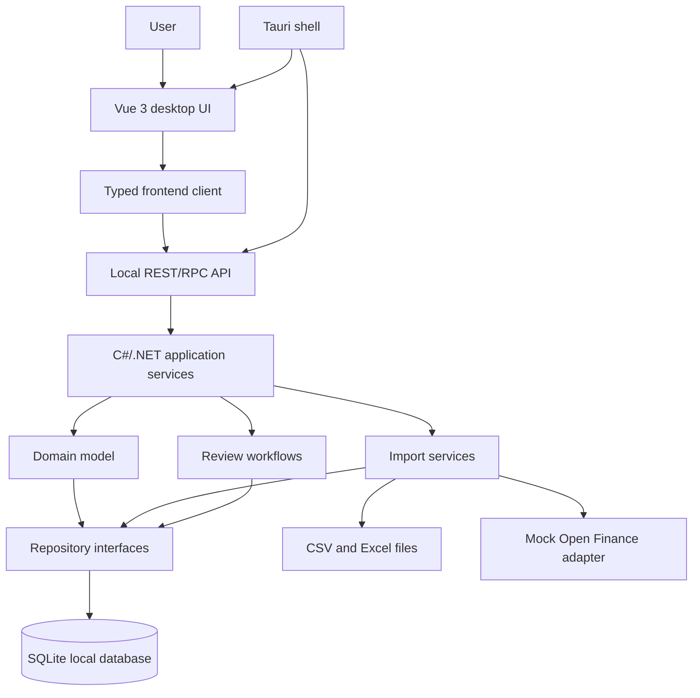
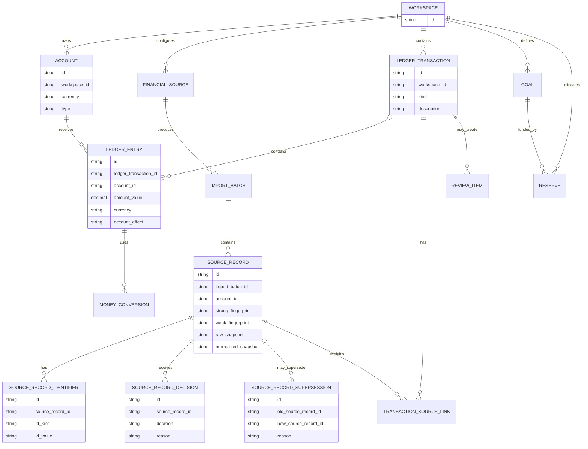
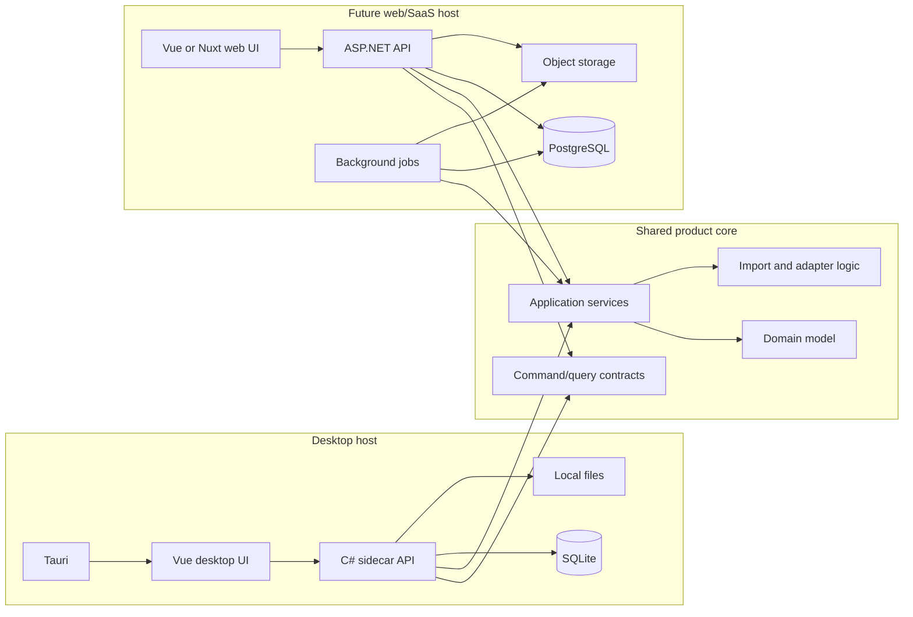

# Technical details

This document captures technical decisions and remaining open questions before
turning the use-case specification into implementation work. The goal is to make
the engineering tradeoffs explicit without keeping already-settled decisions in
the discussion queue.

## Current working approach

The current preferred direction is a local-first desktop application for a
personal or family-scale user. The architecture should stay broad enough to test
several product flows early, but the first serious domain investment should be
the transaction ledger, source snapshots, imports and goals/reserves.

Preferred desktop shape:

- Tauri desktop shell.
- Vue 3 frontend.
- CSS or SCSS for styling. React-based frameworks and Tailwind-like utility CSS
  are out of scope.
- C#/.NET application backend running as a bundled desktop sidecar.
- SQLite as the local database.
- Local-first operation, with optional encrypted cloud storage or sync later.
- Manual transaction entry, CSV import and Excel import as PoC import sources.
- A mock Open Finance adapter shaped around the Open Finance Chile
  specification, before depending on real providers.
- Current-record storage plus raw source snapshots and change metadata. Full
  event sourcing is not required for the PoC.

The main reason for preferring C# over Rust for the domain/backend layer is
developer familiarity and reviewability. Tauri still needs Rust for the desktop
shell, but the Rust layer can stay thin if the financial domain, import logic,
storage access and application services live in .NET. This adds packaging and
process-management complexity, but it keeps the most complicated product logic
in a strongly typed language that is easier to maintain for this project.

The desktop app should use an explicit command/query boundary instead of direct
database access from the frontend. GraphQL is not a good first fit because the
important operations are financial commands and workflows, not arbitrary graph
queries.

Preferred desktop call shape:

```text
Vue UI
  -> typed frontend client
    -> local REST/RPC-style API exposed by the C# sidecar
      -> application services
        -> domain model
          -> SQLite repositories
```



Example command/query style:

```text
POST /commands/create-transaction
POST /commands/import-file
POST /commands/link-source-record
POST /commands/create-goal
GET  /queries/accounts
GET  /queries/transactions
GET  /queries/import-batches/{id}
GET  /queries/review-queue
```

The first ledger model should distinguish imported or manual source facts from
the user-facing logical transaction:

- `source_records`: raw or parsed records from manual entry, CSV, Excel or mock
  Open Finance.
- `ledger_transactions`: normalized financial movements used by balances,
  reports, goals and projections.
- `transaction_source_links`: links between one logical transaction and one or
  more source records.
- `import_batches`: each file import or mock sync attempt.
- `review_items`: duplicates, ambiguous imports, mutations and discarded
  records.
- `goals` and `reserves`: logical allocation of money, not real money movement.

Source records should be treated as immutable facts, not as mutable workflow
objects. Avoid using a canonical `source_records.status` field for domain truth.
Instead, represent state changes through separate records:

- `source_record_identifiers`: external IDs and other identifiers observed for a
  source record.
- `source_record_decisions`: user or system decisions such as discard, ignore,
  merge or keep separate.
- `source_record_supersessions`: one source record superseding another after a
  provider mutation, corrected file row or pending-to-final transition.
- `transaction_source_links`: source records linked to ledger transactions.
- `review_items`: open review workflows caused by ambiguity, duplicates,
  mutations or conflicts.

Statuses such as new, linked, discarded, superseded or needs review should be
derived in query/read models from these facts and decisions. The frontend can
receive those statuses as screen-specific DTO fields, but they should not be the
source of truth.

Manual transactions should also create a lightweight manual `source_record`.
This keeps provenance consistent across manual entry, CSV, Excel and future API
imports:

```text
manual source record -> ledger transaction
file source record   -> ledger transaction
API source record    -> ledger transaction
```

File imports should assume overlapping re-imports are normal. The same CSV or
Excel file may be imported again, or a later file may include older rows plus new
transactions. The import pipeline must therefore be idempotent across repeated
and overlapping files by using stable internal IDs, external identifiers when
available, source fingerprints, user decisions and tombstones/discard records.

CSV and Excel imports should be mapped to a single account before parsing rows
into source records. If a file contains movements for multiple accounts, the PoC
should ask the user to split the data into separate files or sheets and import
each account separately. This keeps the initial fingerprinting and deduplication
model simpler and safer.

Each imported transaction source record should store fingerprints used for
idempotency and duplicate detection:

- `strong_fingerprint`: based on account, financial source and external/provider
  ID when a trustworthy external ID exists.
- `weak_fingerprint`: based on account, date, amount, currency, normalized
  description, counterparty and source context when external IDs are missing or
  unreliable.

Both fingerprints should be persisted because external IDs may be missing,
unstable or reused. Fingerprints are not user-facing identity; they are matching
signals used by import, deduplication, tombstone checks and mutation detection.

Source records should keep both `raw_snapshot` and `normalized_snapshot` for the
PoC:

- `raw_snapshot`: the original file row, sheet name, headers, provider payload or
  manual-entry input as faithfully as practical.
- `normalized_snapshot`: Lukas's parsed interpretation of that source
  record before it becomes a ledger transaction.

Keeping both makes import debugging and review decisions easier. One can be
removed later if storage cost or duplication becomes a real problem.

Imported data may preserve statement-oriented fields such as `inflow`, `outflow`
or provider-specific direction labels in the raw or normalized snapshot. The
ledger model should not use signed money or inflow/outflow as its core truth.
Ledger entries should use a positive amount plus explicit account effect:

```text
ledger_transaction
  kind: expense | income | transfer | adjustment | allocation | refund | fee

ledger_entry
  account_id
  amount_value
  currency
  account_effect: increase | decrease
```

This keeps business meaning separate from account-balance effect. For example, a
credit-card purchase is still an expense, but it increases a liability account
instead of decreasing an asset account.

Money conversions should be modeled as observations attached to ledger entries,
not as a single mutable converted amount. A ledger entry can have multiple
conversion observations when those observations represent different lifecycle
states or user decisions:

- institution pending estimate.
- final billed or paid value.
- manual correction.
- reconciled value.
- provider correction.
- fallback historical estimate.

Reports should choose the best available conversion for their context instead of
assuming one global daily exchange rate. Final, manual or reconciled conversions
should beat pending or fallback estimates. If a fallback historical estimate is
used for a past transaction because no better conversion exists, it should be
stored so future reports are repeatable.

Repeated fallback estimates from the same source and same purpose should replace
the previous active estimate instead of accumulating unlimited history. For
example, if the app refreshes a pending USD-to-CLP estimate from the same
exchange-rate source on January 1, 2 and 3, only the latest active fallback
estimate needs to be used. Earlier fallback estimates can be marked replaced or
omitted from long-term history. Meaningful lifecycle observations, such as bank
pending value, final billed value, manual correction or reconciliation, should be
preserved.

Fees, spreads, taxes and card charges should be separate ledger entries when the
source exposes them separately. If the source only gives a final charged amount,
the app should not invent separate fee rows.



Even if the app starts as a single-person tool, tables should include a
`workspace_id` or equivalent boundary from the beginning. The goal is to support
personal or family-style use without committing to a full SaaS permission model
too early.

## Future web and SaaS direction

The web version should be planned as a future host for the same domain and
application model, not as a rewrite of the product logic. The desktop app should
therefore avoid coupling core rules to Tauri, SQLite-specific behavior or local
filesystem assumptions.

Possible future SaaS shape:

```text
Vue or Nuxt web app
  -> ASP.NET API
    -> same application/domain services used by the desktop sidecar
      -> PostgreSQL repositories
        -> object storage for imports, snapshots, exports and documents
```



The desktop and SaaS hosts can then share concepts:

- Same command DTOs where practical.
- Same query DTOs for shared screens.
- Same domain services for ledger, imports, goals/reserves and calculations.
- Different storage adapters: SQLite locally, PostgreSQL in the cloud.
- Different host concerns: local process and file access for desktop; auth,
  jobs, observability and billing for SaaS.

The hardest part of moving from desktop to cloud will not be the UI framework.
The hard parts will be:

- Authentication and workspace membership.
- End-to-end encryption and key recovery.
- Multi-device sync and conflict resolution.
- Background jobs for imports, refreshes and report precomputation.
- SQLite-to-PostgreSQL migration differences.
- Secure storage for provider credentials and external access tokens.
- Operational observability, support tooling and billing if the product becomes
  commercial.

To keep the migration path open, the PoC should:

- Keep domain logic independent from Tauri.
- Keep storage behind repository or persistence interfaces.
- Use explicit command and query contracts.
- Include workspace boundaries in persisted records.
- Store source snapshots in a form that can later move to object storage.
- Avoid assuming a single local filesystem is the permanent source of truth.
- Treat encryption as a product boundary, not only as a database feature.
- Keep space for a future module/plugin system where optional features, such as
  Chile tax support, can add menus, reports or importers without becoming core
  ledger code.

## 1. Product shape and application architecture

Decision for now:

- Lukas starts as a local-first desktop application.
- The first architecture is a broad modular monolith, not serverless-first or
  service-oriented.
- The core financial domain should stay independent from Tauri, Vue, SQLite and
  any future cloud host.
- Offline/local operation is required for manual work and file imports.
- A future web/SaaS host should reuse the same domain and application services.

Still to discuss:

- Exact application boundaries between domain, application services, storage,
  importers and host adapters.
- Whether a CLI helper is useful later for import/debug/admin tasks.

## 2. Programming language and runtime

Decision for now:

- C#/.NET is preferred for domain logic, application services, imports and local
  backend behavior.
- Vue 3 is preferred for the frontend.
- Tauri remains the desktop shell, with Rust kept as thin as practical.
- The stack is intentionally split: Vue/TypeScript for UI, C# for backend/domain.

Still to discuss:

- .NET version and packaging mode for the sidecar.
- How command/query DTOs are generated or shared with the Vue client.
- Package manager, build system and repository layout.
- Whether future cloud jobs run in the same ASP.NET application, a worker
  service or both.

## 3. Frontend framework and user experience platform

Decision for now:

- Vue 3 is the preferred UI framework.
- React-based frameworks are out of scope.
- Tailwind-like utility CSS is out of scope. Use CSS or SCSS.
- The first UI is desktop-first, dense and operational.
- Nuxt remains a future web/SaaS option, not a requirement for the desktop PoC.

Still to discuss:

- Whether the desktop frontend starts with Vite Vue or another Vue setup.
- Client-side state management for transaction review, duplicate resolution,
  goals/reserves and reports.
- Data visualization library for reports, cashflow, runway and net worth.
- Form handling and validation strategy.
- Accessibility, responsiveness and Chilean Spanish localization details.

## 4. Backend framework and API design

Decision for now:

- The desktop backend is a C#/.NET sidecar.
- The frontend should not access SQLite directly.
- Use a local REST/RPC-style command/query API.
- GraphQL is not a first-fit choice for the PoC.
- Writes should be modeled as explicit commands because financial mutations need
  traceability.

Still to discuss:

- Exact ASP.NET host shape for the sidecar.
- Error model, validation boundaries and problem response format.
- API versioning strategy for future public API and MCP access.
- Whether command/query endpoints are manually typed or generated from contracts.

## 5. Database and persistence model

Decision for now:

- SQLite is the local database for the desktop PoC.
- PostgreSQL is the likely future SaaS database.
- The model should separate source records from ledger transactions.
- Raw import/provider data should be preserved as source snapshots.
- Full event sourcing is not required for the PoC.
- Tables should include a workspace boundary from the beginning.

Still to discuss:

- ORM/query layer for .NET and how portable it should be between SQLite and
  PostgreSQL.
- Initial schema details for accounts, transactions, source records,
  conversions, goals, reserves, periods, reports and review items.
- Migration tooling.
- Seed/test data strategy.
- Whether snapshots live in SQLite initially or in local encrypted files.

## 6. Identity, auth and workspace model

Decision for now:

- The PoC is personal-first.
- Family/household-style use should remain possible without adding a full SaaS
  permission model now.
- Persisted records should include a workspace boundary.
- SaaS auth/provider choice is deferred.

Still to discuss:

- Local profile/unlock model.
- Future workspace membership model.
- Authorization rules for future accounts, reports, integrations, API tokens and
  MCP access.
- Session management and account recovery for future SaaS.

## 7. Security, secrets and compliance posture

Decision for now:

- End-to-end encryption is a desired product constraint.
- Financial data should be treated as sensitive from the beginning.
- Current records plus raw source snapshots and change metadata are enough for
  the PoC audit level.
- Provider tokens should not be exposed to future external tools.

Still to discuss:

- Local database encryption approach.
- Cloud sync encryption and key recovery.
- Where local secrets and future provider tokens are stored.
- Audit logging detail for user edits, imports, external writes and admin
  actions.
- Data retention, deletion, backup and recovery expectations.
- Legal/compliance posture for Open Finance and Chile tax-support features.

## 8. Integration architecture

Decision for now:

- PoC sources are manual entry, CSV import and Excel import.
- Open Finance should be represented first by a mock adapter shaped around the
  Open Finance Chile specification.
- Integrations should produce source records and snapshots before becoming
  ledger transactions.

Still to discuss:

- Adapter interface shape.
- Import pipeline from file/API data through normalization, deduplication, review
  and final ledger state.
- Tombstone/discard model.
- Retry, backoff and error states.
- Future Splitwise, Fintual, aggregator and real Open Finance adapters.

## 9. Background jobs and scheduling

What needs to be discussed:

- Job runner: hosted queues, serverless cron, database-backed queue, worker
  process or managed service.
- Jobs for sync, report precomputation, recurring estimates, period close,
  exchange-rate refresh, stale-balance checks and notifications.
- Idempotency strategy for sync and import jobs.
- Retry policy and dead-letter handling.

Why it matters:

Many important operations happen outside a user request. Syncs and projections
must be repeatable and safe; duplicate imports or partial job failures can
corrupt financial history if idempotency is not designed early.

## 10. Currency, decimal and date handling

Decision for now:

- Period assignment must support multiple period contexts for the same
  transaction. A transaction may belong to a calendar period, budget period,
  credit-card statement period, cashflow period or future tax period.
- The default budget view can use calendar-month periods starting on the first
  day of each month for clarity.
- Source-specific rules are still required. Credit-card statement periods may
  close around days 20-30, while salary or income rules may belong to the last
  days of a month or be reassigned into the intended calendar budget period.
- Salary and recurring income should be assignable to the month it was intended
  to fund, even if it arrives earlier because of weekend, holiday or payment
  timing.
- A transaction's real date should not be rewritten when assigned to a different
  period context.
- Period locking should be optional. Its main purpose is to preserve a reviewed
  historical baseline for later comparison against plans, projections and what
  actually happened. It should not become a mandatory accounting close process
  for the PoC.

Still to discuss:

- Decimal representation for money and exchange rates.
- Currency library and ISO currency handling.
- Timezone policy for users, institutions and reports.
- Date model for transaction date, authorization date, statement date, due date,
  payment date, budget period and tax period.
- Holiday/business-day source for Chile and optional future regions.
- Period rule schema for fixed days, relative dates, source-specific rules and
  manual overrides.
- Period locking, reopening and post-close adjustment behavior.

Why it matters:

Money and dates are core correctness risks. Floating point math, implicit
timezone conversion or a single transaction date would break reports,
projections and reconciliation.

## 11. Reporting and calculation engine

What needs to be discussed:

- Whether reports are calculated on demand, cached, materialized or a mix.
- Shared calculation primitives for spending, cashflow, net worth, goals,
  survival scenarios and health reports.
- How reports represent actual, pending, projected, adjusted and reconciled
  values.
- How to preserve report stability for locked periods.
- Export formats and reproducibility.

Why it matters:

Reports are where users judge whether the product is trustworthy. The reporting
engine must explain its inputs, statuses and assumptions, especially when data is
pending, estimated or manually adjusted.

## 12. Scenario and projection engine

What needs to be discussed:

- How projections are represented: derived views, persisted scenario entities or
  both.
- How scenario assumptions are stored and compared to the baseline.
- How survival scenarios model income loss, severance estimates, liquidity,
  debt payment strategy, reserves and account exhaustion.
- Whether calculations need deterministic snapshots for later review.

Why it matters:

Scenarios should not mutate real history, but they need to reuse real balances,
goals, allocations and recurring transactions. A clear scenario model avoids
mixing hypothetical decisions with the ledger.

## 13. API and MCP strategy

Decision for now:

- Public API and MCP are not part of the initial desktop PoC.
- The local desktop API is an internal command/query boundary, not a supported
  public integration surface.
- Future external API/MCP access should start read-only.
- Selected write workflows may be allowed later through explicit commands, such
  as uploading a bank statement that the main UI cannot map automatically.
- External tools must not receive provider credentials, bank credentials or raw
  integration secrets.

Still to discuss:

- Whether external access uses API, MCP or both.
- Authentication and scoped permissions for external tools.
- Audit and rollback strategy for external writes.
- Rate limits, revocation and secret isolation.
- Which resources and reports are safe to expose first.

## 14. Cloud services and deployment

Decision for now:

- The first deliverable is cheap local desktop, not hosted SaaS.
- Future SaaS likely uses ASP.NET API, PostgreSQL and object storage.
- Cloud storage/sync should be optional and encrypted.

Still to discuss:

- Hosting provider.
- Database hosting and backups.
- Object storage provider.
- Queue/worker hosting.
- Environment strategy for local, staging and production.
- Cost expectations for personal use and possible SaaS.

## 15. Testing and quality strategy

What needs to be discussed:

- Unit tests for domain calculations.
- Integration tests for imports, deduplication, sync and period rules.
- End-to-end tests for critical user flows.
- Snapshot/golden tests for reports and scenarios.
- Property-based tests for money/date edge cases where useful.
- Test data fixtures for Chile-specific cases.

Why it matters:

Most defects in this product would be subtle: wrong period, wrong conversion,
double-counted transfer, overwritten user edit. The test strategy should focus
on financial correctness, not just UI rendering.

## 16. Observability and operations

What needs to be discussed:

- Logging, metrics and tracing needs.
- Sync job monitoring and user-visible sync status.
- Error reporting and alerting.
- Audit log queryability.
- Admin/support tooling boundaries.

Why it matters:

When financial data looks wrong, the system needs to explain what happened.
Operational visibility is part of product trust, especially for imports and
background jobs.

## 17. Internationalization and Chile-specific rules

Decision for now:

- Chile is the first locale and rule set, but country-specific behavior should
  not be hardcoded through the whole core.
- The Chile tax/annual summary should be treated as a future module or plugin,
  not as part of the first core budgeting/ledger implementation.
- That module can add its own menu entry and workflows while reading from the
  core ledger, source records, snapshots and reports.
- The core should eventually expose stable extension points so first-party or
  third-party modules can add features without modifying most of the core app.

Still to discuss:

- Default locale, currency and formatting.
- Chile-specific holiday, tax-support, Open Finance and severance assumptions.
- Whether country-specific rules live in configuration, plugins or code modules.
- How to expand beyond Chile without rewriting core models.
- Plugin/module boundaries, permissions and packaging.
- Which core resources are safe for plugins to read or extend.
- Whether plugins can define new importers, reports, menus, settings pages or
  read-only dashboards.

Why it matters:

The product is Chile-centered, but many core concepts are general. Keeping
country-specific behavior modular makes the app easier to maintain and test.

## 18. Development workflow and repository conventions

What needs to be discussed:

- Monorepo vs single app repository.
- Code organization for domain, API, UI, integrations, jobs and shared types.
- Formatting, linting, type checking and test commands.
- CI strategy.
- Documentation and decision-record format.

Why it matters:

Clear conventions reduce friction once implementation begins. The project will
touch several domains, so repository structure should make ownership and
boundaries obvious.

## Suggested next discussion order

1. Repository layout, build system and desktop sidecar packaging.
2. Initial SQLite schema and persistence approach.
3. Local encryption, unlock flow and future cloud-sync encryption.
4. Import pipeline for manual entry, CSV, Excel and mock Open Finance.
5. Money, decimal, currency and date correctness rules.
6. Transaction ledger, source-record linking and review queue behavior.
7. Goals/reserves model.
8. Testing strategy for ledger, imports and money/date edge cases.
9. Future web/SaaS auth, sync, deployment and operations.

This order skips decisions already made and focuses on the remaining topics that
constrain the first implementation pass.
